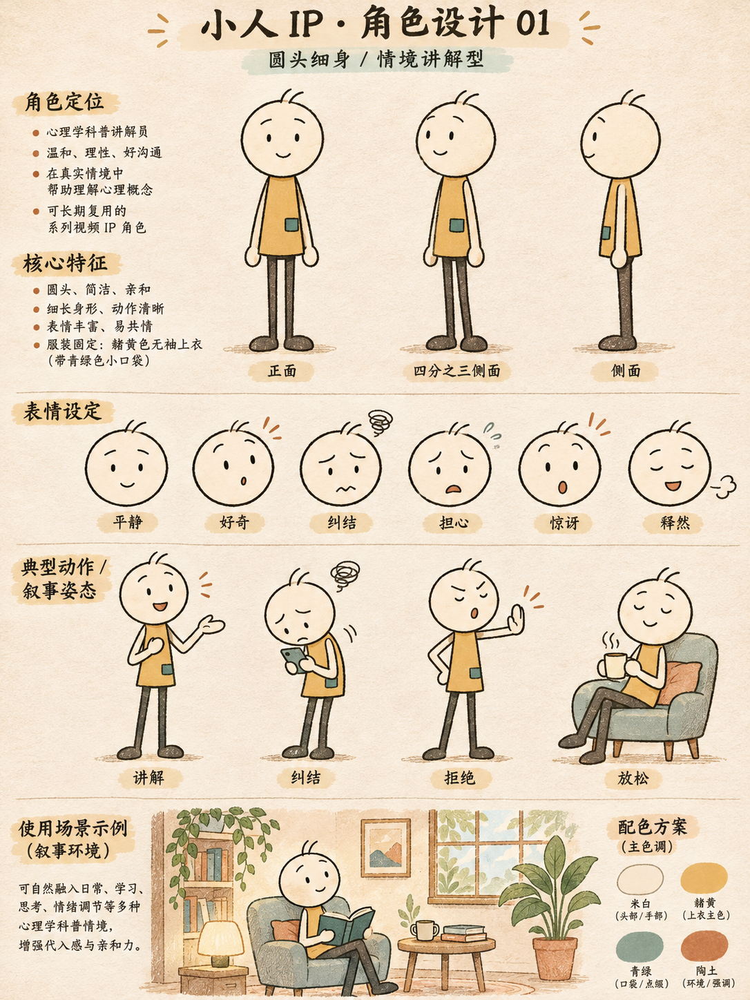

# Stickman_sp

将口播稿转成圆头细身小人 IP 情境插画讲解视频的 Codex skill。

- 固定人物身份，服饰、场景、表情和动作随口播内容变化。
- ElevenLabs V4（`eleven_v4`），使用前检查接口可用性，不自动降级。
- 默认 3:4、1080×1440、30fps，配音对齐决定镜头时间。
- 包含角色设计参考图和参考视频观察记录。

## 安装

将本仓库克隆到 Codex 技能目录：

```sh
git clone https://github.com/wbin888/Stickman_sp.git ~/.codex/skills/Stickman_sp
```

重新启动或刷新技能列表后，提供口播稿并要求使用 `Stickman_sp`。

## 使用示例

> 使用 Stickman_sp，把下面这段口播稿制作成 3:4 小人讲解视频。保留原稿，用 ElevenLabs V4 配音，服饰和场景按内容设计。

## 依赖与边界

此仓库是工作流技能和角色参考资产，不是独立的一键生成程序。运行环境需具备图像生成、ElevenLabs、HyperFrames 和 FFmpeg 能力，以及相应技能。ElevenLabs 凭据仅从环境或私有配置读取；仓库不含密钥。V4 不可用时停止并提示。音色由使用者选择。

技能文件结构已经检查，完整视频生成流水线尚未端到端实测。参考视频采样范围见 references/reference-observations.md。


